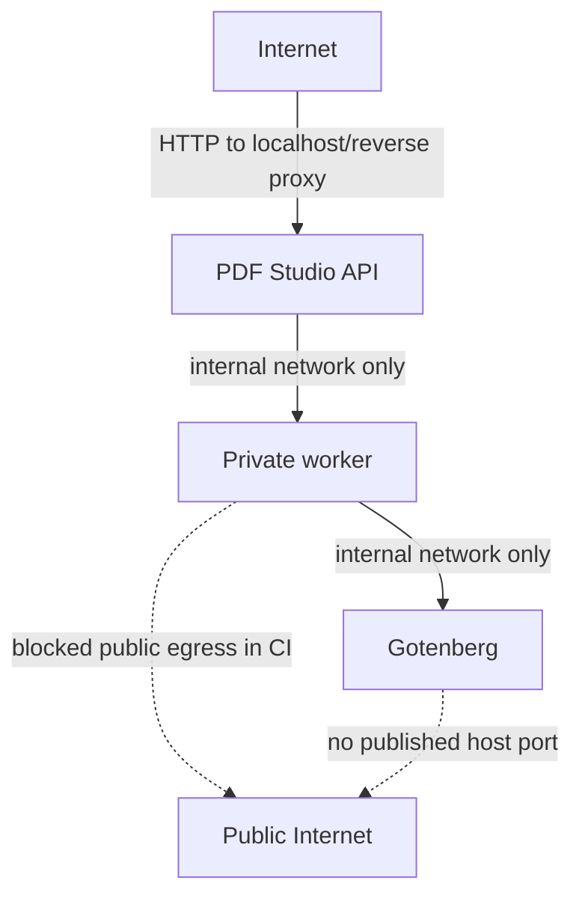
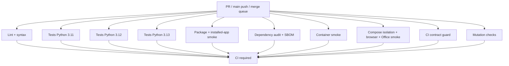
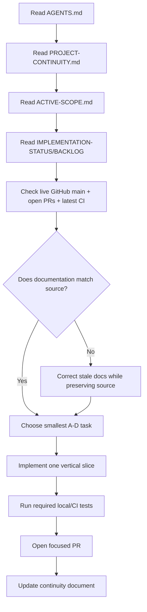

# PDF Studio — Project Continuity / AI Handoff

> **Purpose:** This is the durable continuity document for PDF Studio. Future ChatGPT, Codex, Copilot, Claude, Gemini, or human contributors should read this file before making architecture or implementation decisions.
>
> **Snapshot date:** 2026-11-16 (Asia/Kolkata)
>
> **Repository:** https://github.com/renoukhan39-bit/pdfstudio
>
> **Important:** This file summarizes the visible project/chat context and verified repository evidence available at the snapshot date. It does **not** contain hidden chain-of-thought/private scratchpad. Some older chats are available only as project excerpts rather than complete transcripts; those limitations are recorded below.
>
> **Maintenance rule:** When a milestone PR merges, an engine/version changes, a major decision is accepted, or scope changes, update this file and the session archive.

---

## 1. Executive project state

PDF Studio is an independently branded PDF platform under active development. The current product is a **working prototype**, not a finished commercial service.

### Authorized scope

Only **Stages A–D** are authorized:

- **Stage A:** engineering foundation, safety, isolation, CI, reproducibility.
- **Stage B:** core PDF utilities and document conversions.
- **Stage C:** viewer and professional editor capabilities.
- **Stage D:** OCR, signing, secure redaction, advanced/professional operations.

**Stages E and F are frozen.** Do not implement AI PDF chat, AI summarization, AI translation, subscriptions/billing, user accounts, enterprise organizations, collaboration, cloud document history, or large automation platforms unless the owner explicitly changes scope.

### Current implementation snapshot

On `main` at the beginning of the PPTX milestone, PDF Studio had:

- FastAPI backend.
- pypdf-based PDF toolkit.
- 15 prototype tools including DOCX-to-PDF.
- Basic HTML/CSS/JavaScript frontend.
- Internal processing worker.
- Gotenberg 9 conversion service.
- Docker Compose deployment.
- Pytest and GitHub Actions.
- Playwright browser smoke tests.
- Upload validation/resource limits.
- Private worker/Gotenberg network.

The PPTX milestone is implemented in **open PR #19**, which raises the tool count to **16 tested prototype tools** when merged.

### Live work at this snapshot

- **PR #19:** PPTX-to-PDF via existing private Gotenberg worker  
  https://github.com/renoukhan39-bit/pdfstudio/pull/19
- **PR #19 final head:** `4de25046f37ea214257b01ae7b23dd6a30fcfa30`
- **Final CI:** run #54, all required jobs passed  
  https://github.com/renoukhan39-bit/pdfstudio/actions/runs/43745920531
- **Unrelated open PR #8:** Dependabot Python base image `3.12-slim -> 3.15-slim`  
  https://github.com/renoukhan39-bit/pdfstudio/pull/8  
  Do not merge automatically just because it is open.

Before acting on any live status, verify GitHub again because this document is a point-in-time snapshot.

---

## 2. Source-of-truth documents

Read these before major changes:

1. `AGENTS.md`
2. `README.md`
3. `PUBLIC_PDF_REPOSITORIES.txt`
4. `docs/START-HERE.md`
5. `docs/ACTIVE-SCOPE.md`
6. `docs/ARCHITECTURE.md`
7. `docs/IMPLEMENTATION-CHECKLIST.md`
8. `docs/IMPLEMENTATION-STATUS.md`
9. `docs/IMPLEMENTATION-BACKLOG.md`
10. `docs/CORE-TOOLKIT.md`
11. `docs/REUSE-VS-BUILD.md`
12. `docs/LICENSING-AND-DEPENDENCIES.md`
13. `docs/QUALITY-AND-TESTING.md`
14. `docs/CODEX-PLAYBOOK.md`
15. `docs/CI.md`
16. `docs/DECISIONS.md`
17. `docs/FEATURE-INVENTORY.md`
18. `docs/PPTX-MILESTONE-AUDIT.md` — added by PR #19.
19. `docs/RESEARCH-TOP-2.md` — added by PR #19.
20. **This file:** `docs/PROJECT-CONTINUITY.md`.
21. `docs/CHAT-ARCHIVE-2026-11-16.md` — visible chat/session archive.

When documentation disagrees with current source, current source + passing CI evidence wins; then correct the stale documentation.

---

## 3. Implemented architecture map

### Current implemented request path

```mermaid
flowchart LR
    A[Browser<br/>HTML/CSS/JS] --> B[FastAPI app/main.py]
    B --> C[Raw body + upload limits<br/>app/upload_limits.py]
    C --> D[Format / request validation]
    D --> E[app.worker.execute]
    E --> F[Private worker service<br/>app/worker_service.py]
    F --> G[Bounded child process]
    G --> H{Operation engine}
    H -->|Core PDF tools| I[pypdf toolkit<br/>app/toolkit.py]
    H -->|DOCX/PPTX conversion| J[Gotenberg adapter<br/>app/gotenberg.py]
    J --> K[Private Gotenberg 9<br/>LibreOffice]
    I --> L[Output validation]
    K --> L
    L --> M[FastAPI response]
    M --> N[Browser download]
    N --> O[Optional<br/>Use result in another tool]
```



### Container/network trust boundary



Important implemented controls:

- Worker has no public host port.
- Gotenberg has no public host port.
- Processing network is internal in Compose.
- Worker/Gotenberg run with read-only filesystem/root restrictions and resource limits.
- CI verifies non-root identity, read-only code filesystem and blocked public egress.
- Request adapters disable environment proxies and redirects.
- Gotenberg endpoint is operator configuration, not user request data.
- PR #19 additionally rejects public converter hostnames.

This is **meaningful isolation**, but it is not a perfect hostile-document VM sandbox.

---

## 4. Main modules and responsibilities

| Path | Responsibility | Important notes |
| --- | --- | --- |
| `app/main.py` | FastAPI routes, upload reading, status/error mapping, download responses | PR #19 adds `POST /api/tools/pptx-to-pdf` |
| `app/toolkit.py` | Tool catalog and pypdf operations | Core PDF tools stay here; do not duplicate with Gotenberg without evidence |
| `app/pdf_engine.py` | Shared PDF byte/page limits and merge validation | Keep existing limits unless an evidence-based change is approved |
| `app/gotenberg.py` | Trusted Office conversion adapter | PR #19 generalizes DOCX -> shared OOXML DOCX/PPTX validation/conversion |
| `app/worker.py` | Private-worker routing + bounded child execution | Office conversions must reuse this path |
| `app/worker_service.py` | Private worker HTTP boundary | No public port |
| `app/upload_limits.py` | Raw-body bounds before multipart parsing, concurrency limits | Security-critical |
| `app/page_decorations.py` | Page number/watermark/crop operations | Crop is not secure redaction |
| `app/static/app.js` | No-build browser workspace, upload/options/download/chaining | Extend rather than migrate to React without evidence |
| `app/static/index.html` | Branded interface | Tool count/copy must remain truthful |
| `app/static/styles.css` | Responsive styling | Preserve mobile-width behavior |
| `compose.yaml` | API/worker/Gotenberg topology | PR #19 pins Gotenberg immutably |
| `.github/workflows/ci.yml` | Required quality/test/package/audit/container/integration/guardrail/mutation gates | Never weaken to make a PR green |

---

## 5. Current tools and feature status

Status semantics:

- `PLANNED`: accepted backlog, not implemented.
- `IN_PROGRESS`: active implementation.
- `TESTED`: implemented with meaningful automated/real output verification.
- `SHIPPED`: production/release quality; do not use casually.

No current prototype feature should be called `SHIPPED` merely because unit tests pass.

### Tested prototype set after PR #19

Core PDF tools include merge, split, extract, delete, reorder, rotate, compress, metadata, text extraction, protect, unlock, page numbers, text watermark and visual crop, plus:

- DOCX-to-PDF — TESTED through private Gotenberg.
- PPTX-to-PDF — TESTED in PR #19 through private Gotenberg.

### Important honest limitations

- Visual crop/whiteout is **not secure redaction**.
- PDF text extraction is **not OCR**.
- PDF.js is **not native text editing**.
- Drawing new text over old text is **not underlying text modification**.
- Password protection is **not a certificate signature**.
- Prototype implemented != production ready.

---

## 6. Primary upstream research decision

Exactly two primary repositories were selected.

### 6.1 Gotenberg

- Repository: https://github.com/gotenberg/gotenberg
- Selected release: **v9.5.1**
- Tag commit: `2a025609d36eb7a970c31397e652ee439a7214fe`
- Project license: MIT
- Role: private server-side Office/document conversion.
- PR #19 tested container:
  `gotenberg/gotenberg:9.5.1@sha256:a0f596c2aeee6391c24ccf2953737971f13976b14d4240525a447f209185e2c8`

Why selected:

- Already integrated and working for DOCX.
- LibreOffice route handles DOCX/PPTX/XLSX and other Office formats.
- One stable HTTP boundary is simpler than a second converter backend.
- Existing worker/network/test architecture can be reused.
- No reason to replace working pypdf operations.

Do **not**:

- Copy Gotenberg's Go server into PDF Studio.
- Expose Gotenberg publicly.
- Accept arbitrary user-supplied conversion URLs.
- Enable arbitrary remote document retrieval without a new security review.
- Add another converter for the same feature without benchmark evidence.

Runtime/license caution:

Gotenberg's MIT license does not automatically cover the entire container. The exact image includes separately licensed runtime components such as LibreOffice, Chromium, Debian packages, fonts and other dependencies. Production redistribution needs image-level license/SBOM/security review.

### 6.2 Mozilla PDF.js

- Repository: https://github.com/mozilla/pdf.js
- Selected release: **v6.5.438**
- Tag commit: `0a4153349dc473ba950fc17941c5ca7eda43c1de`
- License: Apache-2.0
- Role: Stage C browser PDF viewer/workspace foundation.
- Current status: selected/researched, **not yet integrated**.

Initial Stage C reuse targets:

- High-quality PDF rendering.
- Page thumbnails.
- Page navigation.
- Zoom.
- Text selection.
- Text search.
- Rotated/mixed-size pages.
- Responsive layout.
- Keyboard interaction/accessibility.
- Future annotation UI foundation.

Do **not** claim PDF.js provides arbitrary high-fidelity underlying-PDF-text rewriting.

Self-host audited PDF.js assets. Do not send local preview PDFs to a third-party CDN/service.

---

## 7. Why other repositories are secondary

`PUBLIC_PDF_REPOSITORIES.txt` is the full study catalog.

General conclusions:

- **pdf-lib / Konva / pdfme:** possible targeted Stage C helpers, not replacements for Gotenberg/PDF.js.
- **OCRmyPDF:** strong Stage D OCR specialist.
- **pyHanko:** strong Stage D signing/validation specialist.
- **qpdf / PDFBox / pdfcpu:** useful only when a demonstrated gap exists; avoid unnecessary duplicate engines.
- **PDFClear / Folio:** study UX/editor interaction patterns; do not merge entire applications blindly.
- **Commercial SDKs such as Apryse/Nutrient:** only for separate native-text-editing research with owner approval, license/cost analysis and proof of real underlying-content modification.
- Do not introduce AGPL, noncommercial, source-available or paid SDK components into the intended proprietary product without explicit owner approval/license review.

---

## 8. PPTX-to-PDF milestone — implementation record

### API

`POST /api/tools/pptx-to-pdf`

Input: one PPTX file.  
Output: validated downloadable PDF.

### OOXML/PPTX validation

PR #19:

- Retains the 8 MiB input limit.
- Requires ZIP/OOXML structure.
- Requires `[Content_Types].xml`.
- Requires `ppt/presentation.xml`.
- Requires the exact PowerPoint main content type.
- Rejects a DOCX renamed to `.pptx`.
- Rejects invalid ZIP/non-PPTX archives.
- Bounds entry count.
- Bounds total declared expanded size.
- Bounds per-entry expansion.
- Bounds compression ratio.
- Rejects unsafe/duplicate archive paths.
- Rejects encrypted OOXML archives.
- Does not extract the OOXML package to the filesystem.

### Gotenberg request restrictions

- Fixed trusted route: `/forms/libreoffice/convert`.
- No user-provided converter URL.
- Environment proxies disabled.
- Redirects disabled.
- Public converter hostnames rejected by PR #19.
- Compose service name/private literal addresses permitted.
- No parallel conversion backend.

### Output validation

Converted output must:

- Have `application/pdf` response MIME.
- Start with a PDF signature.
- Parse strictly with pypdf.
- Be unencrypted.
- Have 1–200 pages.
- Stay <= 40 MiB.

### Error model

- Invalid input / converter rejection -> sanitized 422-class response.
- Temporary Gotenberg/network failure -> sanitized 503 with retry semantics.
- Converter-unavailable category survives API -> worker -> child boundaries.

### Frontend

The existing no-build frontend:

- Shows PowerPoint-to-PDF.
- Accepts PPTX.
- Explains current limits.
- Converts/downloads.
- Shows meaningful errors.
- Can reuse resulting PDF in another tool.
- Remains usable at mobile widths.
- Does not migrate the app to React.

---

## 9. PPTX tests and evidence

PR #19 added coverage for:

- Valid PPTX acceptance.
- Invalid file rejection.
- Non-PPTX OOXML/ZIP rejection.
- Oversized input.
- Excessive expanded ZIP.
- Aggressive compression ratio.
- Unsafe archive paths.
- Wrong converter response type.
- Corrupt PDF output.
- Gotenberg unavailable.
- Existing DOCX regression.
- Strict valid PDF/page-count validation.
- Existing worker reuse.
- Sanitized worker/converter outage propagation.
- Browser: PPTX upload -> convert -> download -> reopen/validate -> use result in another tool.
- Real private-Gotenberg conversion using a dependency-free synthetic PPTX.

### Final CI evidence

Final PR #19 run:

- URL: https://github.com/renoukhan39-bit/pdfstudio/actions/runs/43745920531
- CI run number: **54**
- Head: `4de25046f37ea214257b01ae7b23dd6a30fcfa30`
- Result: **success**

Evidence from the run:

- `python scripts/check.py` passed.
- Plain `python -m pytest -q` passed.
- 80 tests passed.
- 77 subtests passed.
- Branch-inclusive coverage: **91.42%**.
- Required minimum remained **85%**.
- Ruff passed.
- Build/package smoke passed.
- Dependency audit passed with no advisory exclusion.
- Container smoke passed.
- Mutation tests passed.
- CI contract passed.
- Compose startup passed.
- Immutable Gotenberg image assertion passed.
- Private worker/Gotenberg isolation passed.
- Browser flow passed.
- DOCX smoke passed.
- PPTX smoke passed with expected slide text and sensible page count.

The synthetic PPTX expected text is:

`PDF Studio PowerPoint smoke test`

---

## 10. CI contract

Current required CI jobs include:



Rules:

- Never remove failing checks to get green.
- Never reduce the required coverage threshold.
- Never remove critical tests.
- Never add a security-audit exclusion merely to pass.
- Keep the Python version matrix.
- Keep package/install evidence.
- Keep Docker/Chromium integration evidence.
- Keep mutation/guardrail jobs.
- Treat `CI required` as the aggregate gate.

Common commands:

```bash
python scripts/check.py
python -m pytest -q
python -m ruff check app tests scripts
python -m pytest -q --cov=app --cov-branch --cov-report=term-missing --cov-fail-under=85
python -m build
python -m pip_audit --skip-editable
docker compose up --build -d --wait
python scripts/gotenberg_smoke.py
python scripts/pptx_smoke.py
python scripts/browser_smoke.py
```

If Docker or Chromium is unavailable in a local environment, rely on GitHub Actions for that verification and say so explicitly; do not claim unrun commands passed.

---

## 11. Security audit summary

### Existing strengths

- Raw request bytes bounded before multipart parsing.
- Per-file/combined upload limits.
- Processing slots and wall timeout.
- Linux CPU/address-space/core-dump limits for child work.
- Temporary upload handles closed on exit paths.
- Private worker service.
- Private Gotenberg service.
- Read-only filesystem/container restrictions.
- Dropped capabilities/no-new-privileges.
- Resource limits.
- Environment proxies disabled on private adapters.
- Redirects disabled.
- Strict converted-PDF validation.
- No document database/cloud history added.
- Browser chaining avoids unnecessary server persistence.

### Remaining security gaps

- Container isolation shares the host kernel.
- Public production needs TLS.
- Public production needs auth/rate limits/per-user quotas.
- Cross-replica/global compute quotas are incomplete.
- Retention/deletion policy requires owner decision.
- Production monitoring/incident response missing.
- Container image scanning/SBOM review remains.
- Full hostile-document corpus is incomplete.
- Office fidelity/security corpus is small.
- Reverse-proxy/edge controls need production design.

Treat every PDF and Office file as untrusted.

Never log private document contents or passwords.

---

## 12. Licensing status

### PDF Studio original code

**No owner-approved project-wide software license is selected.**

Public visibility is not the same as an open-source license.

Do not silently choose a license for the owner.

### Current main dependencies

Version/license details are tracked in `pyproject.toml` and `docs/LICENSING-AND-DEPENDENCIES.md`. Recheck exact versions when they change.

### Gotenberg

- Project: MIT.
- Container: includes separately licensed components.
- Need production image-level license/SBOM/vulnerability review.

### PDF.js

- Apache-2.0.
- Future bundled distribution must retain required license/attribution material and third-party notices.

### Native text editing

Commercial SDK decision remains open. Do not purchase/integrate a paid SDK without owner approval.

---

## 13. Documentation problems already identified/corrected in PR #19

Before PR #19, docs contained stale/contradictory claims such as:

- 14 tools in some files.
- 15 tools in other files.
- Gotenberg still described as “planned”.
- Worker isolation described as not implemented despite Compose isolation existing.

PR #19 updates the relevant documentation to distinguish:

- implemented/tested prototype,
- production-ready/shipped,
- planned/research.

Future agents should actively check for similar drift.

---

## 14. Next ten implementation tasks

This is the current recommended order after PPTX-to-PDF.

| # | Task | Acceptance criteria |
| --- | --- | --- |
| 1 | XLSX-to-PDF | Validate workbook OOXML/content types, reject DOCX/PPTX/renamed ZIP, reuse worker/Gotenberg, synthetic cell/table text + page verification, browser chaining, all DOCX/PPTX regressions green |
| 2 | Office fidelity corpus | Fonts, tables, charts, themes, multilingual text, malformed packages; document expected output and resource ceilings |
| 3 | Controlled HTML-to-PDF | Bounded HTML/assets ingestion; no arbitrary URL/SSRF path; no third-party preview leakage |
| 4 | PDF-to-image | Bounded DPI/pages/output, correct dimensions/order, raster-memory limits |
| 5 | Image-to-PDF | Bounded JPEG/PNG, preserve ordering/orientation, reopen PDF and verify page count/dimensions |
| 6 | Initial PDF.js viewer | Self-host v6.5.438 assets, render current PDF, thumbnails, navigation, zoom, no external document requests |
| 7 | PDF.js search/accessibility cleanup | Text selection/search, rotated/mixed pages, keyboard navigation, mobile responsiveness, object-URL/document/worker cleanup |
| 8 | Native existing-text editing research | Underlying content really changes; extraction proves change; font/layout benchmarks; license/cost comparison; no overlay substitute |
| 9 | OCRmyPDF Stage D slice | Isolated searchable-PDF OCR, multilingual fixtures, bounded time/size, verify text layer |
| 10 | Secure redaction + signing design gates | Redaction passes forensic recovery checks; signing passes independent cryptographic validation |

### Next smallest PR

**XLSX-to-PDF only.**

Do not combine it with PDF.js, HTML conversion, OCR, accounts, billing or AI.

---

## 15. Stage C PDF.js plan

### Initial viewer acceptance

- Render current uploaded PDF.
- Navigate pages.
- Show thumbnails.
- Zoom.
- Select text.
- Search text.
- Handle rotated pages.
- Handle mixed page sizes.
- Remain responsive.
- Clean object URLs/resources on replacement.
- Support keyboard navigation.
- Avoid third-party document transfer.
- Preserve existing download/tool-chaining workflow.

### Build strategy

Current frontend is no-build HTML/CSS/JS.

Default assumption: extend it safely first.

Introduce a minimal build/copy step only if audited PDF.js asset management genuinely needs it.

Do **not** migrate to React/Next.js merely to add a viewer.

### Native text editing is separate

PDF.js viewer/editor UI features do not prove arbitrary native existing-text modification.

Native-text research must verify:

- underlying text object/content stream changes,
- extracted text after editing,
- font/layout fidelity,
- multilingual/complex-script behavior,
- no hidden old text under an overlay,
- clear commercial license/cost.

---

## 16. Stage D plan

Later Stage D candidates:

- OCRmyPDF for searchable scanned PDFs.
- Multilingual OCR fixtures.
- True secure redaction with forensic verification.
- pyHanko-style certificate signatures and validation.
- PDF/A/conformance checks.
- Repair/professional page operations.

Each must have:

- tested output,
- explicit limitations,
- security review,
- license review,
- real end-to-end acceptance evidence.

---

## 17. Owner/AI working rules

The owner has a constrained coding/AI budget and wants credit-efficient development.

Working strategy:

- Reuse existing working code.
- Reuse mature compatible public engines.
- Do not ask expensive coding agents to rebuild solved components.
- Give expensive coding agents narrow blockers with clear tests.
- Let GitHub Actions make wrong changes fail loudly.
- Keep PRs focused.
- Preserve existing behavior.
- Prefer verifiable progress over speculative architecture.

The owner previously asked to freeze Stages E/F and prioritize A–D.

---

## 18. Historical project-chat context available to this session

The project context exposes these older excerpts. They are not complete transcripts.

### 2026-11-13 — repository/project planning

Owner asked to:

- check the updated repository,
- report status,
- explain the complete project idea,
- identify repositories to learn from or integrate,
- define start-to-end tasks,
- divide work around testing/tool limits,
- conserve expensive coding-model credits,
- reuse public repositories where appropriate,
- keep optimized/new code for stronger coding models,
- block Stages E/F and complete A–D first.

Owner later asked again to check open PRs and preserve the public-repository study list in the repo.

### 2026-11-14 — CI / implementation

Owner asked to:

- start implementing,
- build complete GitHub Actions so other developers/AI can contribute safely,
- make wrong changes fail tests,
- work in focused time/credit constraints,
- push implementation rather than only plan,
- improve CI so other AI tools can work safely.

### 2026-11-15 — project chat access / repository list

Owner asked whether the assistant could access other project chats, then asked to:

- inspect open PRs,
- merge only when appropriate/authorized,
- list previously recommended study repositories,
- create a text file,
- push it to the current repository.

That work produced/updated `PUBLIC_PDF_REPOSITORIES.txt` and supporting docs on `main`.

For more of the current visible conversation, see `docs/CHAT-ARCHIVE-2026-11-16.md`.

---

## 19. Important GitHub links

### Main repository

- https://github.com/renoukhan39-bit/pdfstudio

### Current PPTX feature

- PR #19: https://github.com/renoukhan39-bit/pdfstudio/pull/19
- Final CI #54: https://github.com/renoukhan39-bit/pdfstudio/actions/runs/43745920531
- Final head: https://github.com/renoukhan39-bit/pdfstudio/commit/4de25046f37ea214257b01ae7b23dd6a30fcfa30

### Main baseline at start of PPTX milestone

- `main` commit: `5fc186c8817bc7719b543e029e7ee0b20386e91f`
- Baseline CI #50 was green before PPTX work.

### Primary upstreams

- Gotenberg: https://github.com/gotenberg/gotenberg
- Gotenberg v9.5.1: https://github.com/gotenberg/gotenberg/releases/tag/v9.5.1
- Mozilla PDF.js: https://github.com/mozilla/pdf.js
- PDF.js v6.5.438: https://github.com/mozilla/pdf.js/releases/tag/v6.5.438

### Later specialists

- OCRmyPDF: https://github.com/ocrmypdf/OCRmyPDF
- pyHanko: https://github.com/MatthiasValvekens/pyHanko
- pdf-lib: https://github.com/Hopding/pdf-lib
- Konva: https://github.com/konvajs/konva
- pdfme: https://github.com/pdfme/pdfme
- qpdf: https://github.com/qpdf/qpdf

The complete repository study list is `PUBLIC_PDF_REPOSITORIES.txt`.

---

## 20. How a new AI session should start

A future AI should perform this sequence:



### Before coding

Verify:

- current default branch head,
- open PRs,
- latest CI,
- scope,
- engine/version decisions,
- current tool count,
- whether the intended task is already implemented,
- license implications.

### During coding

- Do not replace working modules just because another framework is fashionable.
- Do not copy full public applications into the repo.
- Do not weaken tests.
- Do not invent production-readiness claims.
- Keep private documents out of logs/issues/fixtures.
- Use synthetic fixtures.

### After coding

Update:

- tests,
- relevant status docs,
- decision docs when architecture changes,
- this continuity file,
- session archive if the work materially changes project state.

---

## 21. Known unresolved decisions

Owner approval still required for:

1. Original PDF Studio source-code license.
2. Contribution policy.
3. Public production hosting/provider.
4. Retention/deletion/privacy policy.
5. Commercial native-text-editing SDK spend, if any.
6. Public deployment security/rate-limit strategy.
7. Any paid infrastructure/service.

Do not silently decide these.

---

## 22. Definition of “done” for a feature

A feature is not complete merely because the engine exposes an API.

A strong acceptance gate includes:

- real code,
- correct API/UI integration,
- synthetic and edge-case tests,
- negative/security tests,
- actual output reopened and validated,
- expected text/pages/structure checked,
- browser flow where relevant,
- worker/isolation path preserved,
- license/security review,
- docs updated,
- limitations stated,
- required CI green.

Only then can it be `TESTED`. `SHIPPED` requires broader release/production evidence.

---

## 23. Continuity change log

### 2026-11-16

Created this continuity/handoff document because long ChatGPT conversations were becoming difficult to reload reliably. Goal: make the GitHub repository itself the durable project memory.

The companion visible-chat archive is:

`docs/CHAT-ARCHIVE-2026-11-16.md`

A human-readable Word snapshot is also stored as:

`docs/PROJECT-CONTINUITY.docx`

Future updates should keep the Markdown version authoritative because GitHub, code search and coding agents can parse it directly.

